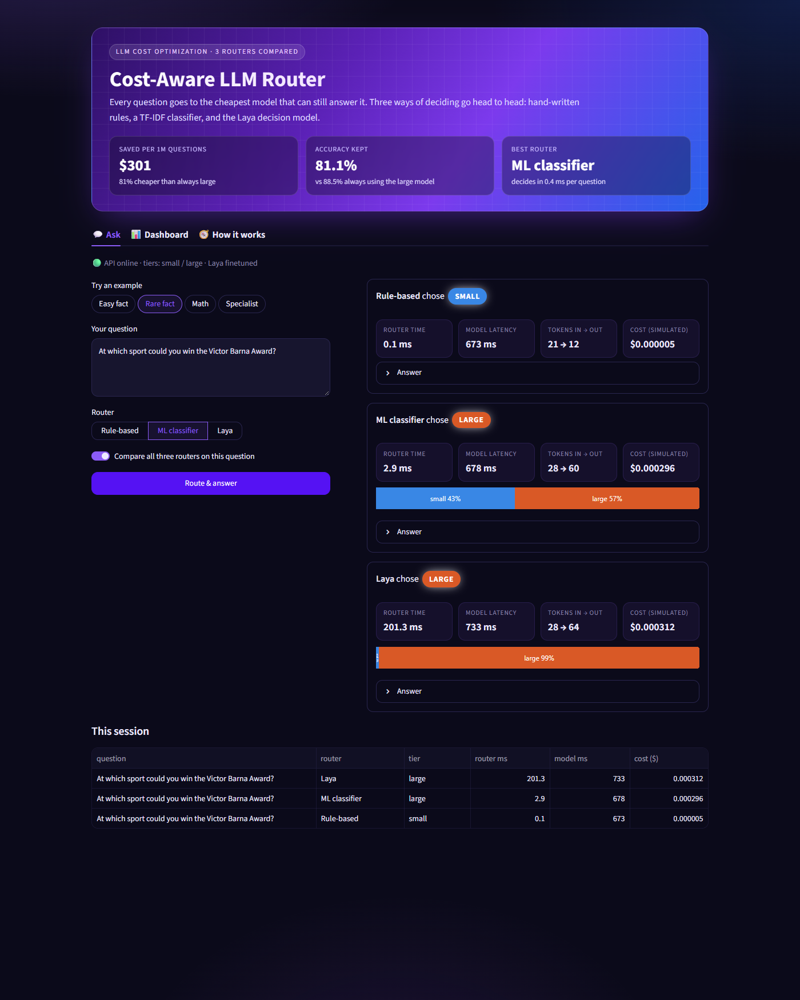
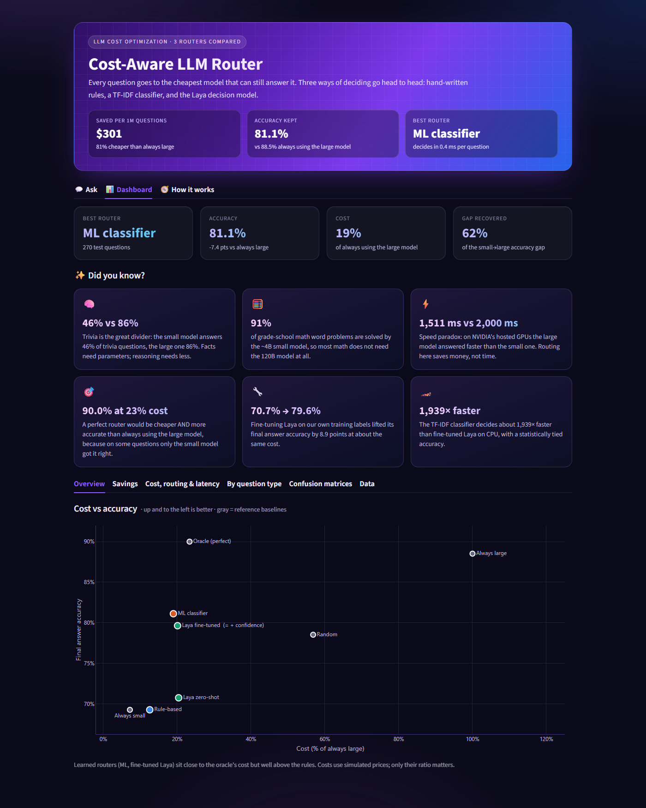
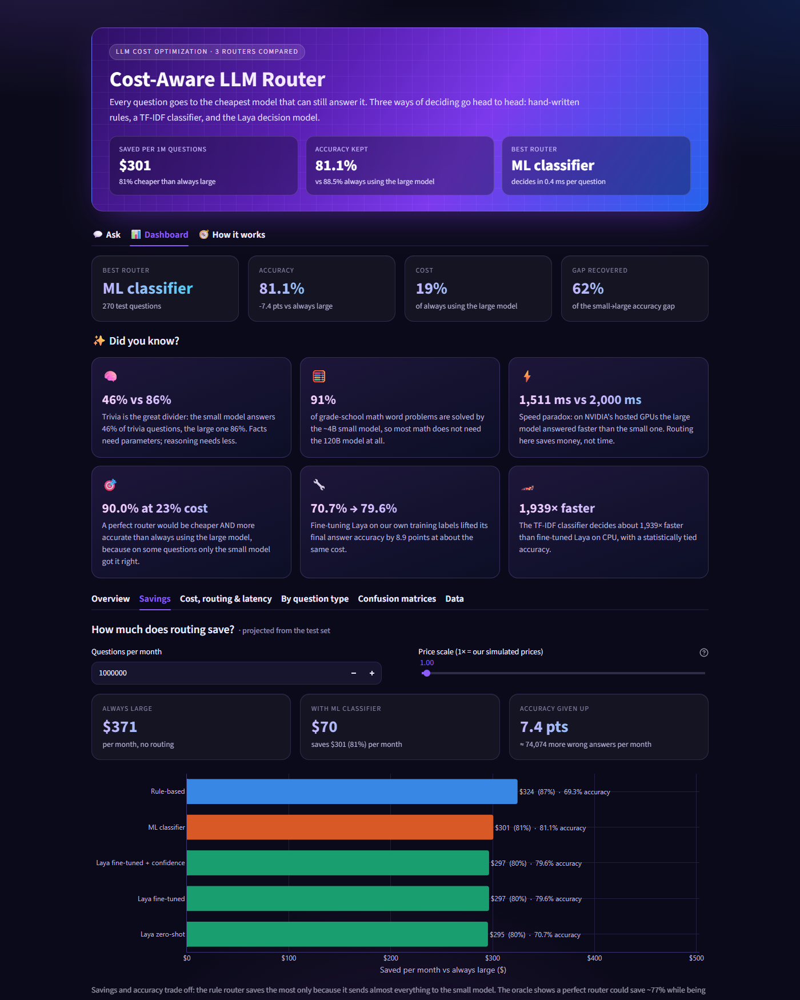
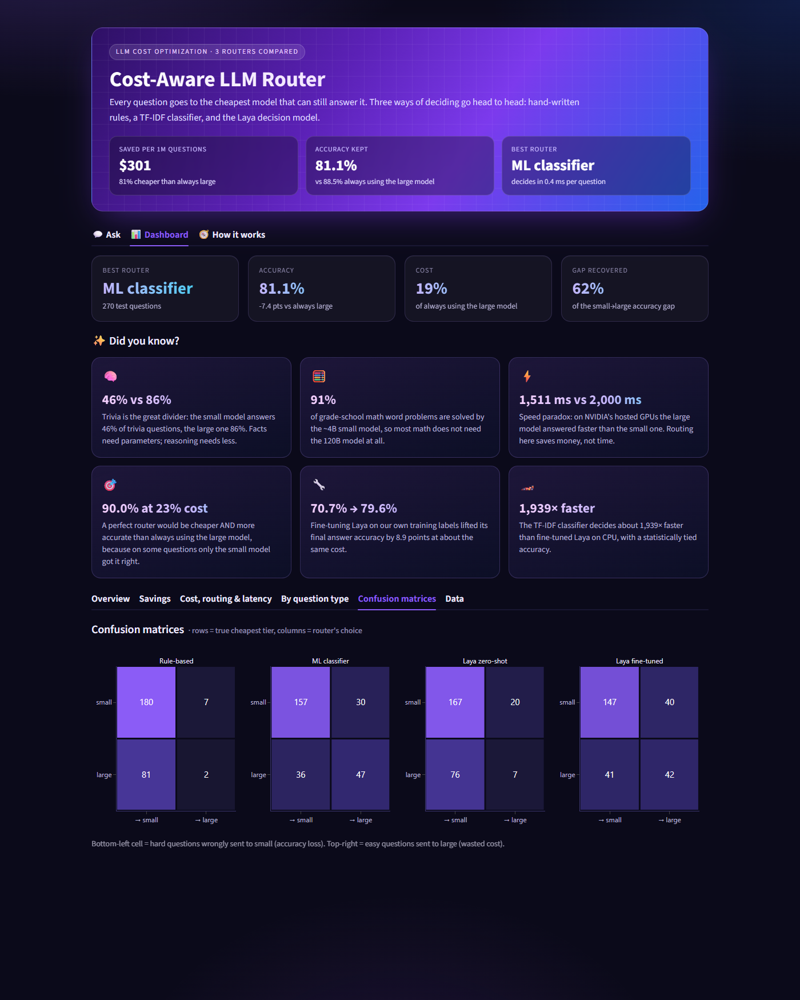
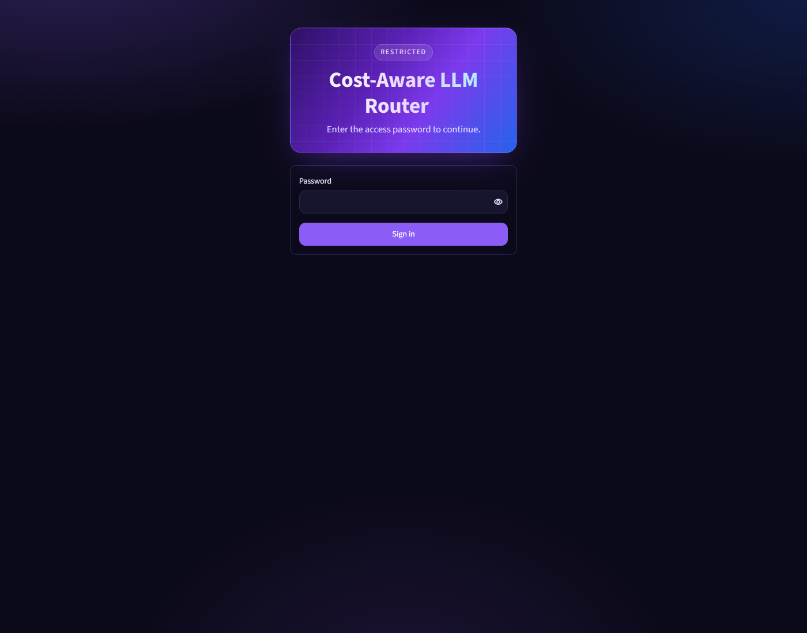
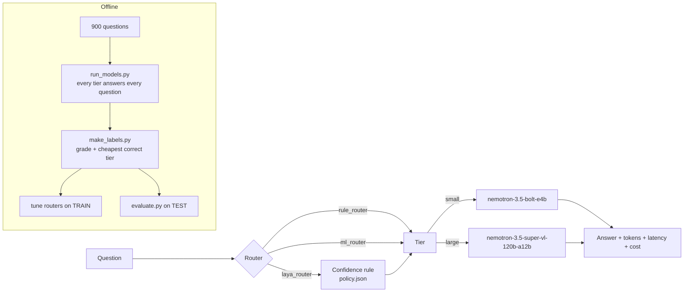
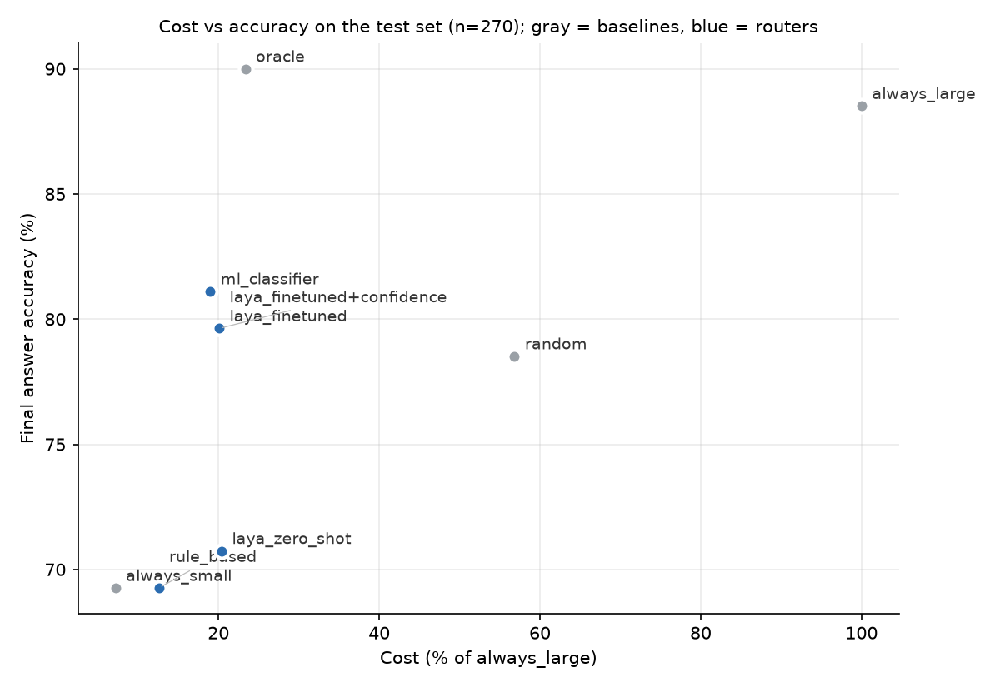
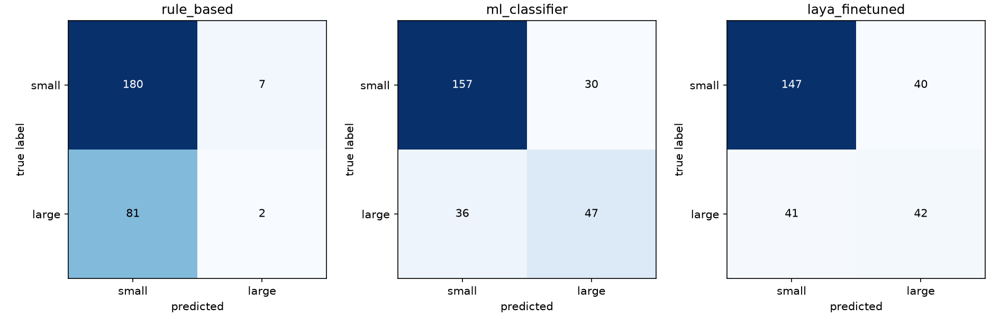

# Cost-Aware LLM Router: Rule-Based vs ML vs Laya

For each question, pick the **cheapest LLM tier that still answers it correctly**, and compare
three routers fairly on the same held-out test set.

**Headline:** a learned router keeps **81.1% accuracy for 19% of the cost** of always using the
large model (88.5%). Fine-tuned Laya beats hand-written rules by **+10.3 points** (95% CI
[+6.7, +14.1]) and ties a TF-IDF classifier that decides about 1,900× faster.



<details>
<summary>More screenshots</summary>






</details>

## Quick start (Docker)

```powershell
copy .env.example .env     # fill in NVIDIA_API_KEY, APP_API_KEY, UI_PASSWORD
docker compose up -d       # API on 127.0.0.1:8000, UI on http://localhost:8501
```

The Laya fine-tuned checkpoint (808 MB) is not in the repo. Train it with
`notebooks/laya_finetune.ipynb` and unzip it into `routers/laya_checkpoint/`; without it the API
falls back to zero-shot Laya, and the rule and ML routers work as normal.

## Project structure

```
llm-router/
├── config.py, llm_client.py     # settings from .env; one ask() for every tier
├── scripts/                     # build_dataset, run_models, make_labels, evaluate
├── routers/                     # rule_router, ml_router, laya_router, policy (+ saved rules/models)
├── notebooks/laya_finetune.ipynb# fine-tune Laya on Kaggle or Colab
├── app/main.py                  # FastAPI: /ask, /health, /usage
├── ui/streamlit_app.py          # Streamlit frontend (Ask, Dashboard, How it works)
├── data/, results/              # labels, predictions, comparison table, charts
├── Dockerfile.api, Dockerfile.ui, docker-compose.yml
└── .env.example                 # every setting, with placeholders only
```

## Problem

Sending every question to the strongest model gives the best accuracy and the highest bill.
Many questions are easy enough for a small, cheap model. A router that predicts which
questions need the strong model can cut cost while keeping most of the accuracy. The open
question is **which kind of router does that best**.

## Solution

1. Every question is answered by every tier once, and each answer is graded against a known gold answer.
2. Label = the cheapest tier that answered correctly (if none did, the label is `large`).
3. Three routers learn to predict the label from the question text alone, tuned on TRAIN only:
   - **Rule-based**: 7 hand-written features → weighted score → threshold, with a grid search for the weights.
   - **ML classifier**: TF-IDF features and logistic regression.
   - **Laya**: a 0.4B decision model asked a typed `choice` question, used zero-shot and fine-tuned on our labels.
4. The TEST split is evaluated by **simulation** from the saved answers, so no new LLM calls are made and every router sees identical answers.



## Models

All tiers are served by the NVIDIA API (`https://integrate.api.nvidia.com/v1`, OpenAI-compatible),
with `temperature=0` and model "thinking" turned off so every tier answers directly.

| Tier | Model | Simulated price per 1K tokens (in / out) |
|---|---|---|
| small | `nvidia/nemotron-3.5-bolt-e4b` | $0.0001 / $0.0002 |
| large | `nvidia/nemotron-3.5-super-vl-120b-a12b` | $0.0020 / $0.0040 |

**The prices are simulated.** The API is free, so we assigned realistic relative prices (large ≈ 20× small).
Costs are in "simulated dollars", and the conclusions depend on the *ratio* of the prices.

**Why 2 tiers and not 3:** the planned medium tier (`nvidia/nemotron-3.5-lightning-30b-a3b`) was
heavily rate-limited (HTTP 429) on the free endpoint. Replacement candidates were either not served
(404) or took about 22 s per call, which would have distorted the latency comparison. The pipeline is
tier-agnostic: set `ACTIVE_TIERS=small,medium,large` in `.env`, run the medium tier on all
questions, and re-run the same scripts.

## Dataset and labeling

900 questions, sampled with seed 42 and split 70/30 train/test, stratified by source:

| Source | Split used | Prompt instruction | Grading |
|---|---|---|---|
| GSM8K (math) | test | "Solve step by step. End your reply with 'Answer: <number>'." | number after `Answer:` (fallback: last number), numeric compare |
| MMLU, "all" (multiple choice) | test | options A–D + "Reply with only the letter…" | first standalone letter A–D |
| TriviaQA, rc.nocontext (facts) | validation | "Answer in as few words as possible." | normalized match against any alias |

Per-tier accuracy on all 900 questions (`python scripts/make_labels.py`):

| Source | small | large |
|---|---|---|
| GSM8K | 91.0% | 97.3% |
| MMLU | 65.3% | 81.0% |
| TriviaQA | 45.7% | 86.3% |
| **Overall** | **67.3%** | **88.2%** |

Label distribution: 606 `small`, 294 `large`. That includes 90 questions that neither tier answered
correctly; these are labeled `large` by rule.

## Rule-based router

Features: word count, count of numbers, math words, reasoning words, multi-step markers, a
short "who/what/when…" fact pattern, and multiple-choice options. The score is a weighted sum,
and the question goes to `large` if the score is at or above the threshold. Weights in {0,1,2}
and thresholds from score quantiles are grid-searched on TRAIN to maximize routing accuracy, and
the result is saved in `routers/rules.json`. Each routing decision takes about 0.03 ms.

## ML classifier router

TF-IDF (1–2-grams) with logistic regression and `class_weight="balanced"`. C is chosen by 5-fold CV
on TRAIN only. Each routing decision takes about 0.4 ms. The model is saved in `routers/ml_router.joblib`.

## Laya router

[Laya](https://huggingface.co/convaiinnovations/laya) is asked one typed question per input question:
`{"type": "choice", "criteria": {"small_model": ..., "large_model": ...}}` via
`agent.predict(state, questions)`. The answer carries `choice` and per-option `probabilities`.

- **Zero-shot**: the base model `convaiinnovations/laya`, with no training.
- **Fine-tuned**: `notebooks/laya_finetune.ipynb` is a single-GPU adaptation of Laya's official fine-tuning
  notebook that runs on Kaggle or Colab. We trained it on Kaggle (T4) for 4 epochs on `laya_train` (85% of TRAIN),
  with validation (15% of TRAIN) held out. Minority-tier rows are oversampled to handle class imbalance, followed by
  the official temperature calibration. The checkpoint goes in `routers/laya_checkpoint/` (808 MB, git-ignored).
- Both variants are timed on the same laptop CPU in the same run, so their `router_ms` values are comparable.

## Confidence rule

If Laya's top probability is below a threshold, the question moves one tier up. The threshold is chosen on
VALIDATION (0.40–0.90 in steps of 0.05), using fine-tuned Laya, to maximize `accuracy − 0.2 × cost/always_large_cost`.
The best value was **0.40**, which bumps **0 of 270** test questions, so `+confidence` equals plain fine-tuned Laya.
On validation, higher thresholds bumped 1–5 questions without raising accuracy (75.8% at every threshold) and only
added cost (up to 30.4%).

Note: with 2 tiers, the top probability is always ≥ 0.5, so thresholds 0.40–0.50 can never bump anything. The rule
only matters above 0.5. The 0.40–0.90 search range was designed for 3 tiers.

## Results (TEST split, n = 270)

From `results/comparison.csv`:

| Strategy | Accuracy | Cost (% of always_large) | Avg latency (ms, incl. router) | Router ms | Routing accuracy | % to large |
|---|---|---|---|---|---|---|
| always_small | 69.3% | 7.2% | 2000 | 0 | 69.3% | 0% |
| always_large | 88.5% | 100.0% | 1511 | 0 | 30.7% | 100% |
| random | 78.5% | 56.8% | 1765 | 0 | 49.3% | 49.6% |
| rule_based | 69.3% | 12.6% | 2007 | 0.03 | 67.4% | 3.3% |
| **ml_classifier** | **81.1%** | **19.0%** | 2089 | 0.4 | **75.6%** | 28.5% |
| laya_zero_shot | 70.7% | 20.4% | 2773 | 913 | 64.4% | 10.0% |
| **laya_finetuned** | **79.6%** | **20.1%** | 2965 | 844 | 70.0% | 30.4% |
| laya_finetuned+confidence | 79.6% | 20.1% | 2965 | 844 | 70.0% | 30.4% |
| oracle (perfect router) | 90.0% | 23.4% | 1854 | 0 | 100% | 30.7% |

Laya router times are CPU timings from the run that produced these predictions. In an earlier zero-shot-only run on
the same laptop they were about 300 ms, so treat them as "hundreds of ms", against well under 1 ms for rules and ML.





**Headline:** fine-tuned Laya reached **79.6% accuracy at 20.1% of always_large cost**, vs rule-based 69.3% at 12.6%.
That's **+10.3 points, a significant difference** (paired bootstrap 95% CI [+6.7, +14.1]). Against the TF-IDF ML classifier
(81.1% at 19.0%), fine-tuned Laya is **statistically tied**: −1.5 points, 95% CI [−4.8, +1.5]. Fine-tuning moved
Laya from 70.7% (zero-shot) to 79.6%.

## Rule-based vs Laya: discussion

- **Rules collapse to "almost always small".** With about 69% of labels being `small`, maximizing routing accuracy
  rewards the majority class. The rule router sends 96.7% of questions to small and catches only 2 of 83
  questions that needed large. Its final accuracy equals always_small.
- **Laya zero-shot knows little about *our* models.** It has never seen how these two Nemotron models perform,
  so it judges "difficulty" from general intuition. It sends 10% to large and catches 7 of 83.
- **Fine-tuning taught Laya where *our* small model fails.** It now sends 30.4% to large, almost exactly the oracle's
  30.7%, and accuracy jumps from 70.7% to 79.6% at about the same cost (20.1% vs 20.4%).
- **Error analysis, fine-tuned Laya vs rules** (`evaluate.py` prints the examples). Laya was right and the rules
  wrong on **29** questions, **27 of them TriviaQA**, for example "Who was married to Guinevere?" and "At which sport could
  you win the Victor Barna Award?". The rules were right and Laya wrong on just 1. The pattern: these are short "who/which"
  questions that look easy to surface features, but they ask for facts the 4B model doesn't know. Fine-tuned Laya
  learned which *kinds of facts* the small model misses, which hand-written features cannot see.
- **The biggest gap is TriviaQA** (small 45.7% vs large 86.3%). That's where learned routers (ML and fine-tuned Laya)
  beat the rules.
- **Fine-tuned Laya vs the ML classifier: a tie in accuracy, a big gap in speed.** Both learn from the same 535–630
  training labels and land within noise of each other. TF-IDF and logistic regression decide in about 0.4 ms; Laya
  takes hundreds of ms on CPU. On this data, the simpler model is the better engineering choice.
- **Latency does not improve with routing here.** On NVIDIA's hosted GPUs the large model averaged 1,370 ms and
  the small one 1,990 ms. The small model also writes longer replies (92 vs 50 output tokens on average). Routing
  saves cost, not time, in this setup, and Laya's CPU overhead adds to it.

**Bottom line for this data:** routing is worth it. Learned routers keep about 80% accuracy (vs 88.5% for always_large)
for about 20% of the cost, recovering 54% (Laya) to 61% (ML) of the accuracy gap between small and large. Fine-tuned Laya
beats hand-written rules by a significant 10.3 points and ties a TF-IDF classifier that is about 2,000× faster to run.

## How to run (Windows PowerShell)

```powershell
cd llm-router
python -m venv venv
.\venv\Scripts\Activate.ps1
pip install -r requirements.txt
copy .env.example .env        # then put your NVIDIA key in .env

python llm_client.py                          # 1. smoke test: one question per tier
python scripts/build_dataset.py               # 2. data/questions.jsonl
python scripts/run_models.py --tier small     # 3. resumable; repeat per tier
python scripts/run_models.py --tier large
python scripts/make_labels.py                 # 4. data/labels.csv
python routers/rule_router.py                 # 5. rules.json + test predictions
python routers/ml_router.py                   #    ML classifier
$env:USE_TF="0"; python routers/laya_router.py   # 6. Laya (zero-shot; fine-tuned if checkpoint exists)
python routers/policy.py                      # 7. confidence threshold on validation
python scripts/evaluate.py                    # 8. comparison table, plots, headline, error analysis
```

## API usage

```powershell
$env:USE_TF="0"; uvicorn app.main:app --port 8000
```

- `GET /health` (public) reports the tiers, which routers loaded, the Laya variant and the confidence policy.
- `GET /usage` (needs the key) shows today's calls and simulated cost against the daily budget.
- `POST /ask` requires the header `X-API-Key: <APP_API_KEY>`. It takes
  `{"question": "...", "router": "rule" | "ml" | "laya"}` and returns `answer`, `chosen_tier`, `router_used`,
  `router_ms`, `model_latency_ms`, `in_tokens`, `out_tokens`, `cost` and `probabilities` (for ml and laya).
- Errors: 401 for a missing or invalid key, 422 for an invalid body (empty, over 2,000 characters, or an unknown router),
  429 when the rate limit or the daily budget is exceeded, 502 if the LLM call fails, and 503 if Laya isn't loaded.

```bash
KEY=<your APP_API_KEY>
curl -X POST localhost:8000/ask -H "Content-Type: application/json" -H "X-API-Key: $KEY" -d '{"question": "What is the capital of France?", "router": "rule"}'
curl -X POST localhost:8000/ask -H "Content-Type: application/json" -H "X-API-Key: $KEY" -d '{"question": "At which sport could you win the Victor Barna Award?", "router": "ml"}'
curl -X POST localhost:8000/ask -H "Content-Type: application/json" -H "X-API-Key: $KEY" -d '{"question": "Pens cost 3 for $4. Maria buys 27 pens and pays with $50. How much change?", "router": "laya"}'
```

## Frontend (Streamlit)

```powershell
streamlit run ui/streamlit_app.py      # with the API already running
```

- **Ask a question:** pick a router, send a question through the API, and see the chosen tier, router time, model
  latency, simulated cost, the answer, and the router's confidence per tier.
- **Results dashboard:** interactive Plotly charts built from `results/` and `data/`: cost vs accuracy, accuracy
  and cost per strategy, routing mix, latency split into model time and router overhead, accuracy by question type,
  a confusion matrix per router, and a table with every number.
- The UI server holds the API key and adds it to requests itself, so **the browser never sees the key**.

## Security

| Measure | Where |
|---|---|
| Secrets only in `.env`, never in code, images or git (`.gitignore`, `.dockerignore`) | config, Docker |
| API-key authentication on `/ask` and `/usage` (`X-API-Key`, constant-time comparison) | `app/main.py` |
| Per-client rate limit (`RATE_LIMIT_PER_MIN`, default 30) returning 429 + `Retry-After` | `app/main.py` |
| **Daily budget cap**: LLM calls are refused (429) beyond `DAILY_CALL_LIMIT` calls or `DAILY_COST_LIMIT` simulated $ per UTC day; counters are rebuilt from the audit log, so a restart doesn't reset them | `app/main.py` |
| **Audit log** `logs/audit.jsonl`: time, client, router, tier, tokens, cost, latency, status, and a SHA-256 *hash* of the question (never the text, never a key) | `app/main.py` |
| **Optional UI login** (`UI_PASSWORD`): constant-time check, lockout after 5 wrong tries in 5 minutes, shared across sessions so reloading doesn't reset it | `ui/streamlit_app.py` |
| Input validation: 1–2,000 characters, router must be `rule`/`ml`/`laya` | `app/main.py` |
| Generic error messages to clients; details logged on the server only | `app/main.py` |
| Security headers: `nosniff`, `X-Frame-Options: DENY`, `no-referrer`, `no-store` | `app/main.py` |
| No CORS: only the Streamlit server calls the API | `app/main.py` |
| Outbound NVIDIA calls: 60 s timeout, retries with backoff, 40 RPM limiter | `llm_client.py` |
| Containers: non-root user, read-only filesystem, `no-new-privileges`, ports bound to 127.0.0.1 | Docker |
| UI container gets only `APP_API_KEY`, not the NVIDIA key (least privilege) | `docker-compose.yml` |

## Docker

```powershell
# Docker Desktop must be running. The checkpoint must exist in routers/laya_checkpoint/
docker compose up --build
```

- **api** (`Dockerfile.api`): Python 3.14-slim, CPU-only PyTorch, pinned requirements (`requirements-api.txt`). The
  808 MB Laya checkpoint is **mounted read-only**, not baked into the image. `./logs` is the only writable mount
  (audit log and budget). A health check uses `/health`.
- **ui** (`Dockerfile.ui`): Streamlit with its own small requirements (`requirements-ui.txt`). It reads `results/`
  and `data/` from read-only mounts and talks to the API over the private compose network (`http://api:8000`).
- Open http://localhost:8501 for the UI, or http://localhost:8000/health for the API.

## Limitations

- **2 tiers, not 3**, because the medium endpoint was rate-limited (see Models).
- **Simulated prices:** absolute dollar values are not real; only the ratios matter.
- **Small test set:** n = 270, so differences of a few points are within noise. We report bootstrap CIs.
- **Grading is string-based:** unusual but correct phrasings can be marked wrong, especially in TriviaQA.
- **The none-correct questions** (90 of 900) are labeled `large`, but large also fails on them. These labels
  add noise and push routers toward paying for questions that no tier can answer.
- **Three question types only:** routers aren't validated on coding, writing or chat.
- **Routing accuracy objective:** tuning rules for routing accuracy favors the majority class. A cost-aware objective
  could change the rule router's operating point.
- **Laya latency is CPU-only:** the router times were measured on a laptop CPU and vary between runs. On a GPU, Laya
  would be much faster.
- **The confidence rule had no effect:** with 2 tiers and this threshold range it bumped no test questions.

## Future work

- Add the medium tier back when a reliable endpoint is available.
- Re-run the confidence rule with thresholds above 0.5 and a cost weight chosen by the use case.
- Tune all routers on the same cost-aware objective, and plot each router's full cost–accuracy curve by sweeping its threshold.
- Add more question types (code, summarization) to test generalization.
- Cloud deployment of the two containers (for example Azure Container Apps), with secrets in a key vault and HTTPS.
- A shared rate-limit store (such as Redis) when running more than one API replica.
